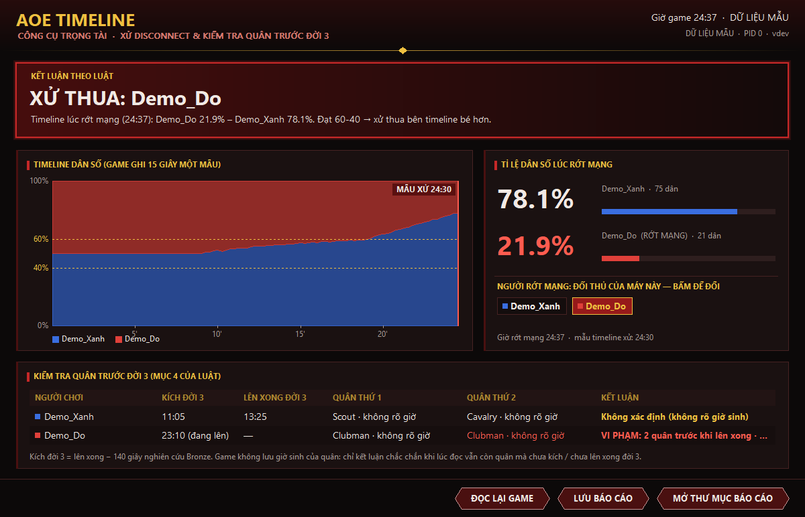

# AoE Timeline: công cụ trọng tài

Công cụ hỗ trợ trọng tài giải AoE (Rise of Rome 1.0, bản AoE-HD / XArena) khi một trận bị **disconnect**. Tool đọc
**timeline**, tức tỉ lệ dân số mà chính game ghi lại để vẽ màn Timeline trong Achievements. Từ đó tool áp **mục 5
của luật**: Solo xét mốc phút 18, 4VS4 xét mốc phút 25, và mức 60-40. Tool cũng kiểm tra **quân trước đời 3**
(mục 4 của luật).



## Dùng ở giải

1. **Khi có disconnect, giữ nguyên game trên máy còn kết nối.** Không thoát trận. Nếu game tự chuyển sang màn
   Achievements thì cũng không bấm thoát khỏi màn đó: dữ liệu trận vẫn còn nguyên trong bộ nhớ cho tới khi rời màn này.
2. Cắm USB có `aoe-timeline.exe`, Alt+Tab ra Windows, chạy file. Không cần cài đặt.
3. Windows hỏi quyền **Administrator**: bấm *Yes*. Game XArena chạy bằng quyền admin, nên phải có quyền này mới đọc
   được bộ nhớ game.
4. Tool tự tìm `EMPIRESX.EXE`, đọc trận và hiện **kết luận theo luật**:
   - **Người rớt mạng.** Ở Solo, mặc định là đối thủ của máy đang chạy tool. Ở 4VS4, trọng tài bấm vào tên người bị
     rớt (khung *Tỉ lệ dân số*). Bấm lại thì đổi người.
   - **Timeline.** Biểu đồ toàn trận; rê chuột lên biểu đồ để xem tỉ lệ ở từng thời điểm. Vạch đỏ là mẫu dùng để xử.
   - **Tỉ lệ dân số lúc rớt mạng** của hai phe.
   - **Quân trước đời 3.** Mỗi người chơi: lúc kích đời 3, lúc lên xong đời 3, quân thứ 1, quân thứ 2 và kết luận.
5. Báo cáo được **tự lưu cạnh file exe** (thư mục `BaoCao-AoE-Timeline` trên USB): file `.txt` đọc bằng Notepad,
   file `.csv` chứa toàn bộ timeline. Nút **LƯU BÁO CÁO** lưu thêm một ảnh `.bmp` của màn hình kết quả.
6. Tắt tool, rút USB. Tool không ghi gì lên máy thi đấu.

Tool chỉ mở game với quyền **đọc bộ nhớ** (`PROCESS_VM_READ`): không ghi vào game, không chèn DLL, không gửi gì ra
mạng. BTC nên thông báo trước với các đội rằng trọng tài sẽ dùng tool này khi có disconnect.

## Tool đọc gì, chính xác đến đâu

| Thông tin | Nguồn trong game | Độ chính xác |
|---|---|---|
| Timeline (dân số từng người) | Mảng lịch sử game dùng để vẽ màn Timeline: 15 giây game một mẫu, mẫu #k lúc k×15 s, giá trị = tổng dân số (dân + quân) | Đúng như màn Timeline của game |
| Giờ rớt mạng | Đồng hồ game, dừng ngay khi mất kết nối | ±2 giây |
| Lên xong đời 2/3/4 | Mốc lên đời mà game gắn vào Timeline | Chính xác |
| Kích đời 3 | Lên xong − 140 giây (thời gian nghiên cứu Bronze Age); nếu đang lên thì = giờ hiện tại − số giây đã nghiên cứu | Chính xác, trừ khi người chơi huỷ rồi kích lại |
| Đơn vị quân | Quân còn sống lúc đọc, sắp theo thứ tự sinh | Xem giới hạn dưới đây |

**Giới hạn về quân:** game không lưu giờ sinh của unit, và tool chỉ được chạy sau khi có disconnect. Vì vậy tool
chỉ thấy các quân **còn sống** lúc đọc, theo đúng thứ tự sinh, nhưng không biết từng quân sinh lúc mấy giờ. Tool
chỉ kết luận **VI PHẠM** khi chắc chắn, tức là lúc đọc:

- người chơi đang có quân mà **chưa kích** đời 3; hoặc
- người chơi đang có **từ 2 quân trở lên** mà **chưa lên xong** đời 3.

Các trường hợp khác (đã lên đời 3, quân sinh không rõ lúc nào) được ghi là **Không xác định**. Trọng tài đối chiếu
thêm bằng bản ghi hình hoặc livestream.

**Đã kiểm chứng** bằng các trận 1v1 do hai bản game chạy ẩn tự đấu, có tắt hẳn một bên để giả lập rớt mạng:

- Đồng hồ game của máy còn lại dừng sau 2 giây. Khoảng 1 phút sau, game tự chuyển sang màn Achievements và xử thua
  chính máy còn lại; người rớt vẫn ở trạng thái "đang chơi". Vì vậy tool không dựa vào trạng thái thắng/thua của game
  để xác định ai rớt.
- Timeline, giờ game và tên người chơi vẫn đọc đúng cả ở màn trận lẫn màn Achievements.

Chi tiết dịch ngược và địa chỉ bộ nhớ: [docs/bo-nho-game.md](docs/bo-nho-game.md).

## Kiểm tra file tải về đúng với mã nguồn

Mỗi bản trên trang [Releases](https://github.com/trandinhnamuet/aoe-timeline-save/releases) được build hoàn toàn
trên GitHub Actions từ mã nguồn của repo này, bằng [workflow release.yml](.github/workflows/release.yml), và được ký
**chứng nhận nguồn gốc** (build provenance, chữ ký Sigstore). Có ba cách kiểm tra:

1. **Chữ ký.** Cài [GitHub CLI](https://cli.github.com) rồi chạy

   ```
   gh attestation verify aoe-timeline.exe -R trandinhnamuet/aoe-timeline-save
   ```

   Lệnh này xác nhận file được build từ commit nào của repo này, bởi workflow nào, và không bị sửa sau khi build.
2. **Mã hash.** `Get-FileHash aoe-timeline.exe` (PowerShell) phải ra đúng SHA-256 ghi trong mô tả Release và trong
   `SHA256SUMS.txt`.
3. **Tự build lại.** Build là tất định: cùng commit và cùng zig thì ra đúng cùng một file.

   ```
   pip install ziglang==0.13.0
   set APP_VERSION=1.0.0          (số phiên bản của tag, không có chữ v)
   python build.py                -> dist\aoe-timeline.exe, in ra SHA-256
   ```

## Phát triển

```
python build.py test      # kiểm thử luật xử (tests/test_rules.c)
python build.py           # build dist/aoe-timeline.exe
dist\aoe-timeline.exe --demo --shot demo.bmp     # xem giao diện bằng dữ liệu mẫu
```

Tuỳ chọn dòng lệnh: `--pid N` chọn tiến trình game, `--dc N` chỉ định người chơi số N là người rớt mạng, `--at mm:ss`
nhập giờ rớt mạng, `--out thư_mục` nơi lưu báo cáo, `--report` chỉ lưu báo cáo rồi thoát.

Mã nguồn C thuần (Win32 + GDI), biên dịch bằng `zig cc`, ra một file exe 32-bit, không phụ thuộc thư viện ngoài
Windows.
